# 图书管理系统 · 软件工程实验

数据库课程设计：一个完整的图书管理信息系统，覆盖**数据库设计**与**应用程序实现**两个阶段。

> MySQL 8.0 · Java 21 · JDBC · Swing

---

## 功能

| 模块 | 功能 |
| :--- | :--- |
| 图书管理 | 图书的增删改查 |
| 读者管理 | 读者信息的增删改查 |
| 借阅管理 | 借书 / 还书 / 未归还清单 |
| 统计查询 | 借阅排行、月度趋势、出版社分布（柱状图） |

业务规则由数据库**触发器**保证（例如拒绝重复借出同一本书）。

---

## 界面

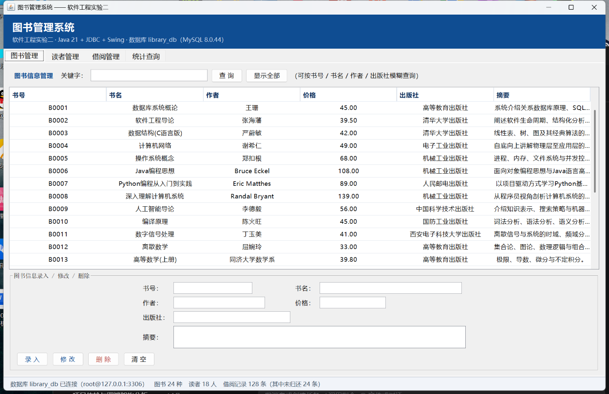
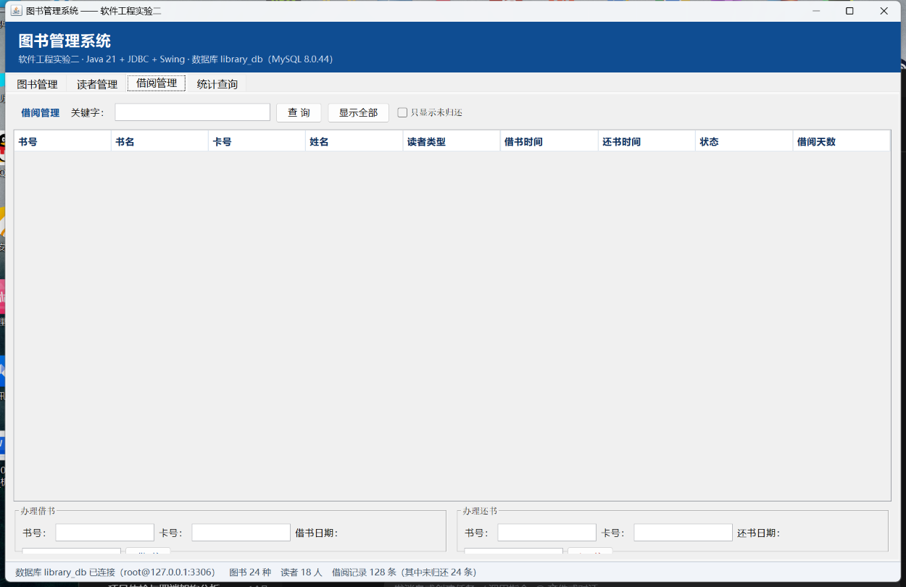

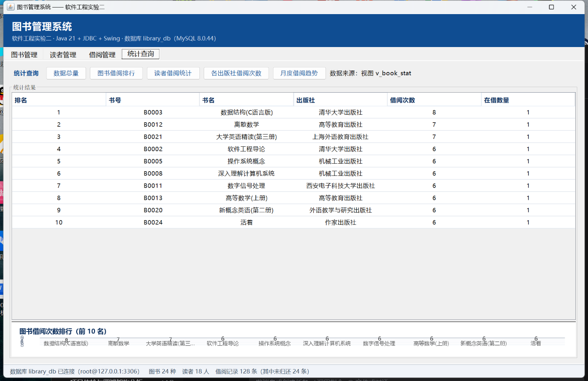
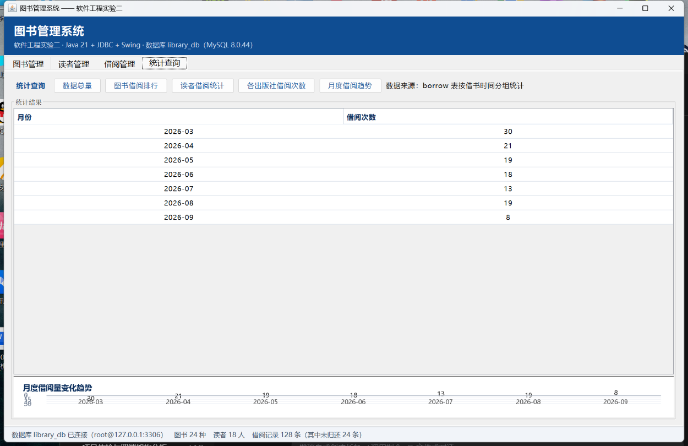

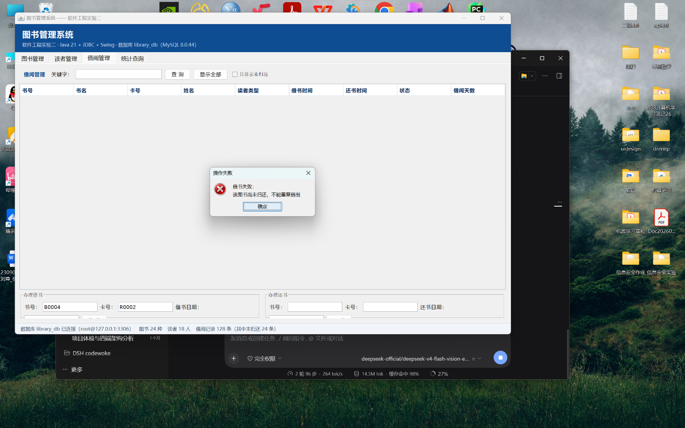

*借书时若该书已被同一读者借出且未归还，触发器直接拒绝并提示 —— 业务规则放在数据库层而不是应用层。*

---

## 设计文档

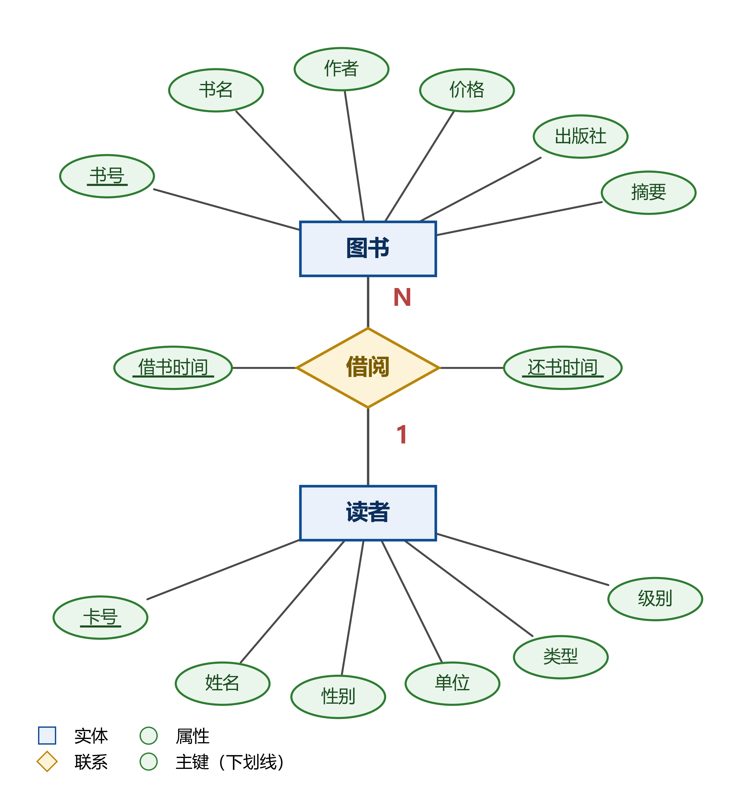

*实体-联系图*

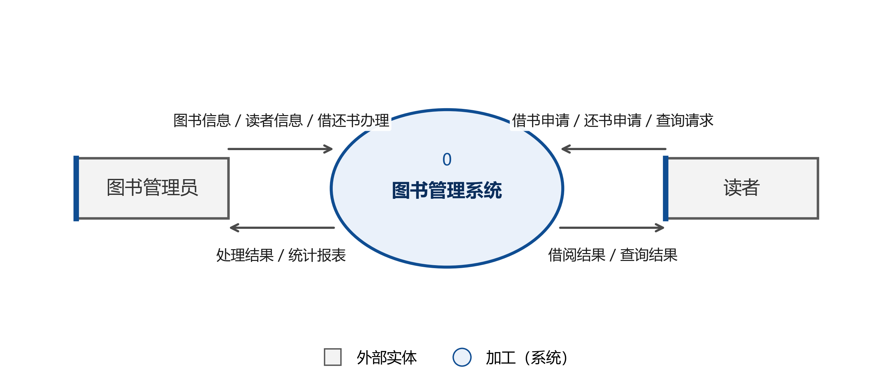
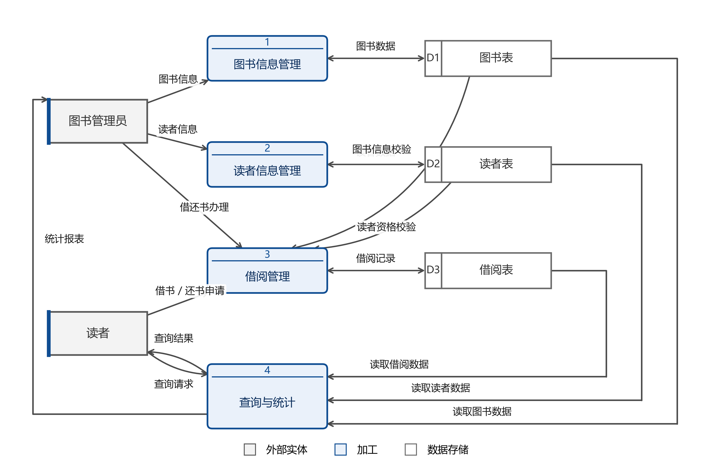

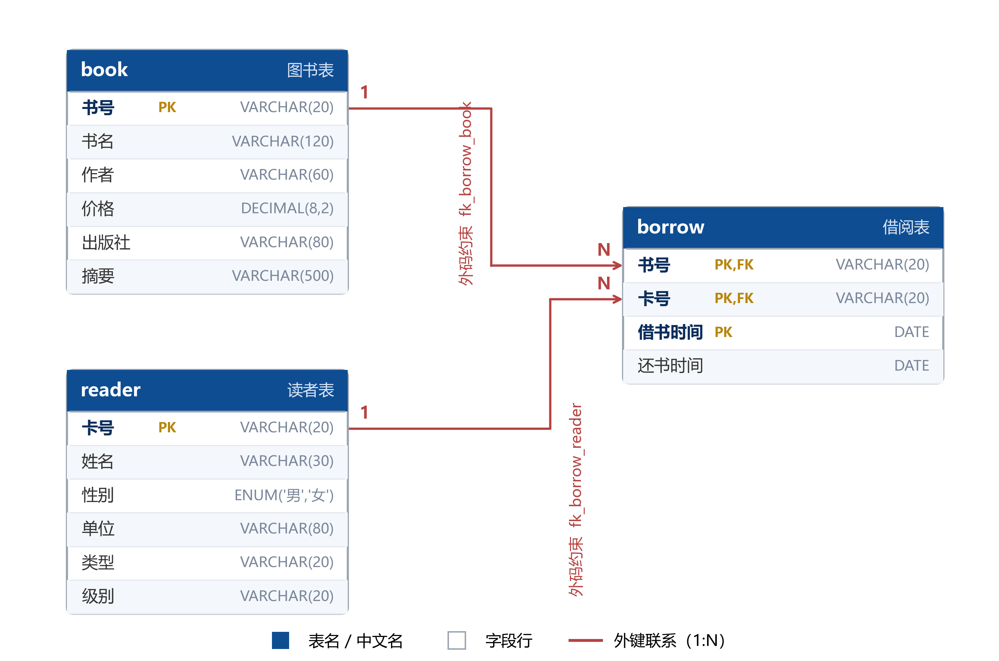

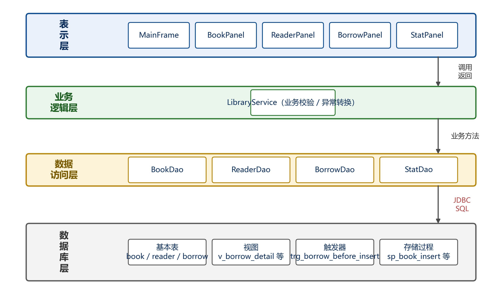

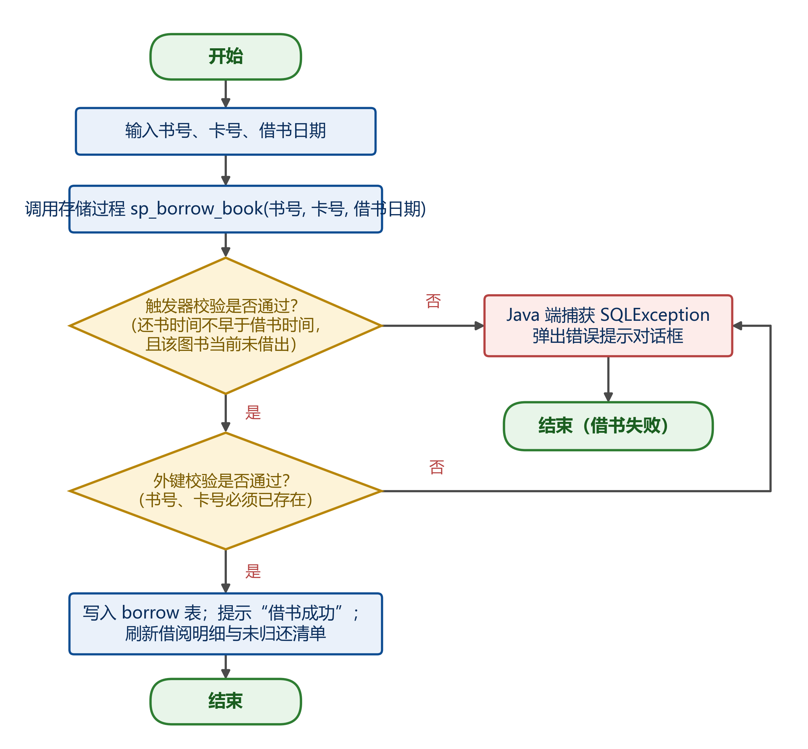

---

## 项目结构

```
.
├── library-app/          Java 应用（Maven 工程）
│   ├── src/main/java/com/library/library/
│   │   ├── App.java              程序入口
│   │   ├── dao/                  数据访问层（BookDao / BorrowDao / ReaderDao / StatDao）
│   │   ├── entity/               实体类
│   │   ├── service/              业务逻辑（LibraryService）
│   │   ├── ui/                   Swing 界面（各功能面板 + 柱状图）
│   │   └── util/DBUtil.java      连接管理
│   ├── src/main/resources/
│   │   └── db.properties.example 连接配置模板
│   └── tools/                    截图与冒烟测试工具
├── sql/                  建库建表脚本 + 示例数据
├── scripts/              图表与报告生成脚本（Python）
├── figures/              ER 图、数据流图、模式图、统计图、结构图、流程图
└── reports/              实验报告（数据库设计 / 应用程序设计）
```

分层清晰：**UI → Service → DAO → 数据库**，各层职责单一。

---

## 数据库设计

| 表 | 说明 |
| :--- | :--- |
| `book` | 图书（ISBN、书名、作者、出版社、库存） |
| `reader` | 读者（借书证号、姓名、类型） |
| `borrow` | 借阅记录（读者、图书、借出日、应还日、归还日） |

设计文档见 [`figures/`](./figures/)：

- `fig1_er_diagram` —— E-R 图
- `fig2_dfd_top` / `fig3_dfd_level1` —— 数据流图（顶层 / 一层）
- `fig4_schema` —— 关系模式图
- `figA2_architecture` —— 系统架构图
- `figA3` / `figA4` —— 图书入库、借阅流程图

图表不是手画的 —— [`scripts/`](./scripts/) 里的 Python 脚本从数据库与配置中读数据自动生成，
改数据后重跑即可刷新（`figstyle.py` 统一了配色与字体）。

---

## 运行

### 1. 准备数据库

```sql
source sql/01_create_database.sql;
source sql/02_sample_data.sql;
```

### 2. 配置连接

**推荐用环境变量**（不要把口令写进文件）：

```bash
set LIBRARY_DB_URL=jdbc:mysql://127.0.0.1:3306/library_db?useUnicode=true&characterEncoding=utf8&useSSL=false&serverTimezone=Asia/Shanghai
set LIBRARY_DB_USER=root
set LIBRARY_DB_PASSWORD=你的口令
```

或复制配置模板：

```bash
copy library-app\src\main\resources\db.properties.example library-app\src\main\resources\db.properties
```

> `db.properties` 已在 `.gitignore` 中，**不会被提交**。

### 3. 编译运行

```bash
cd library-app
mvn clean package
java -jar target/library-app.jar
```

Windows 下也可直接双击 `编译.bat` / `library-app\运行程序.bat`。

---

## 关于凭据

连接参数按 **环境变量 → `db.properties` → 内置默认值** 的顺序解析（见
[`DBUtil.java`](./library-app/src/main/java/com/library/library/util/DBUtil.java) 的 `prop()`）。

真实口令不会出现在版本库里，仓库只提供 `db.properties.example` 模板。

---

## 许可

[MIT](./LICENSE) © 2025 liuzunn
